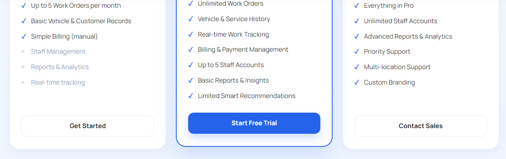
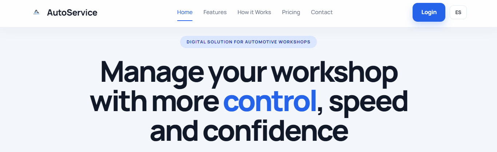
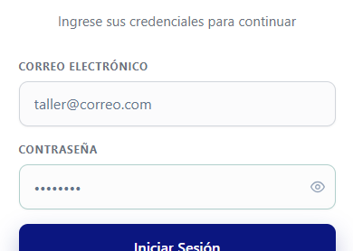
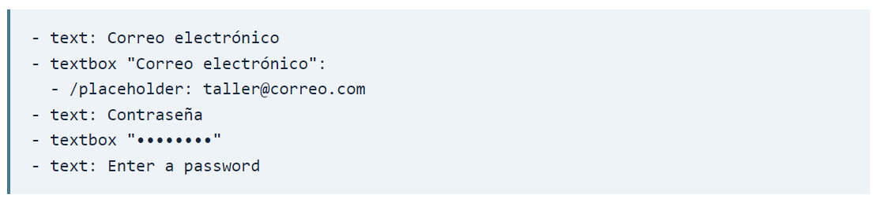
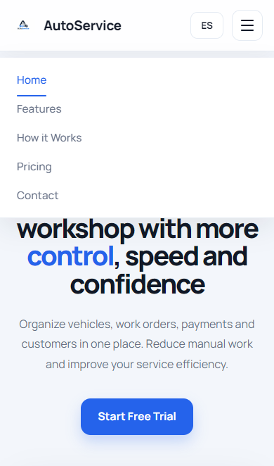
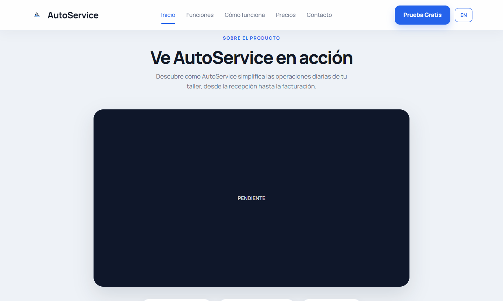
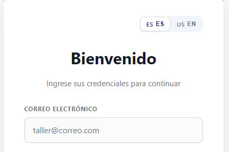
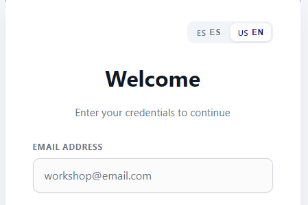

# Evaluación heurística de AutoService

UX Heuristics & Principles Evaluation   /   Usability · Inclusive Design · Information Architecture

Una persona que compara los planes de AutoService llega a los precios, pero los botones de los planes Free y Business la devuelven a la portada. Quien ya es cliente del taller sí puede ir desde el acceso web al portal de seguimiento. Esta revisión documenta ambos recorridos y las barreras que se encontraron al recorrer la landing y el acceso público.

| **Carrera y curso** | Ingeniería de Software · Diseño de Experimentos de Ingeniería de Software (1ASI0732). |
| --- | --- |
| **NRC y profesor** | 9100 · Alex Humberto Sánchez Ponce. |
| **Grupo auditor** | Teralume, equipo de EnergyCore. Inspección técnica asistida por navegador. |
| **Cliente y participantes** | ShiftTech Solutions, equipo de AutoService. Sin participantes del grupo cliente en la inspección. |
| **Sitio y versión** | Landing pública en GitHub Pages y aplicación web en Vercel, tal como se sirvieron el 09/11/2026. |

[Abrir landing de AutoService](https://upc-shift-tech-solutions-team-1.github.io/LandingPage-AutoService/)   ·   [Abrir acceso web](https://autoservice-web-kappa.vercel.app/login)   ·   [Repositorio del informe del equipo](https://github.com/upc-shift-tech-solutions-team-1/report)

### Tareas y alcance

Se siguió la ruta para elegir un plan, localizar la demostración, acceder desde móvil, cambiar el idioma, identificar los campos de acceso y encontrar el seguimiento de una orden. Se abrieron las pantallas de registro y recuperación.

Quedaron fuera la creación de cuentas, la consulta de órdenes con códigos reales, los pagos, el área interna del taller y la aplicación nativa. El informe de ShiftTech del 5 de octubre identifica el proyecto y los segmentos (pp. 1–2) y describe el seguimiento público (p. 247).

### Cronograma de la auditoría realizada

9 de noviembre de 2026, hora de Lima. Entre las 02:10 y las 02:12 se registraron los clics, se repitieron los recorridos y se inspeccionaron el foco y el nombre accesible. Se usó Microsoft Edge 157 en escritorio (1366 × 820) y con vista móvil emulada (390 × 844). La devolución queda a cargo de los dos equipos.

## Resultados de la inspección

Dos problemas tienen prioridad alta: la selección de planes que interrumpe el siguiente paso y la identificación del campo de contraseña mediante tecnología de asistencia. Los otros tres tienen una alternativa de navegación o afectan contenido secundario.

| **ID** | **Problema observado** | **Severidad** | **Heurística o principio** |
| --- | --- | --- | --- |
| AS-01 | Los botones Free y Business devuelven a la portada. | 3 · Mayor | Usabilidad · Correspondencia entre la acción y el resultado. |
| AS-02 | El campo de contraseña se identifica mediante puntos. | 3 · Mayor | Diseño inclusivo · Ofrecer una experiencia comparable. |
| AS-03 | El menú móvil omite el acceso de usuarios existentes. | 2 · Menor | Arquitectura de información · Facilidad para encontrar una ruta. |
| AS-04 | La sección de demostración anuncia contenido que no puede verse. | 2 · Menor | Arquitectura de información · Utilidad del contenido anunciado. |
| AS-05 | El acceso en español conserva el idioma de página inglés. | 2 · Menor | Diseño inclusivo · Comunicar el idioma del contenido. |

### Escala de severidad

1 · Superficial, se supera fácilmente.   2 · Menor, añade una dificultad superable.   3 · Mayor, bloquea una tarea o afecta de forma importante a parte del público.   4 · Muy grave, impide continuar con el producto. Se usa la escala del Anexo D.

### Recorridos que sí se completaron

Desde el login, «¿Es cliente del taller?» abre el Portal de Seguimiento. Al pulsar «Buscar Mi Orden» sin código, la página especifica qué falta. También se abrieron «Recuperar Contraseña» y «Registrar Taller». Alcanzar estas pantallas comprueba la navegación pública; no acredita el envío de correos ni el resultado de una orden válida.

[Abrir el portal de seguimiento](https://autoservice-web-kappa.vercel.app/tracking)

AS-01   /   3 · Mayor   /   Usabilidad · Correspondencia entre la acción y el resultado.

## Los planes pierden su destino

**Dónde se observa.**  Landing en inglés, sección Pricing.

**Cómo reproducirlo.**  Abrir Pricing. Pulsar Get Started en Free. Regresar a Pricing y pulsar Contact Sales en Business.

**Resultado observado.**  En ambos casos la URL termina en /# y reaparece la cabecera de la landing. No se abre el registro ni un canal de ventas.

**Impacto.**  Una persona que ya eligió el plan debe descubrir otra forma de inscribirse o contactar con el equipo de ventas de AutoService.

**Recomendación.**  Enlazar Free con el alta del taller y Business con un contacto de ventas operativo.

**Cómo verificar la corrección.**  Repetir ambas selecciones desde Pricing y confirmar que cada destino corresponde a la etiqueta del botón.

Antes del clic. Los tres botones se muestran debajo de las tarjetas; se comprobaron los dos extremos.

Después de Contact Sales. El navegador vuelve al inicio de la landing.

AS-02   /   3 · Mayor   /   Diseño inclusivo · Ofrecer una experiencia comparable.

## La contraseña se identifica como una serie de puntos

**Dónde se observa.**  Formulario público de inicio de sesión en español.

**Cómo reproducirlo.**  Enfocar el correo, pulsar Tab y revisar cómo identifica el navegador el campo de contraseña. Hacer clic en su etiqueta visible.

**Resultado observado.**  Tab alcanza el campo. El árbol de accesibilidad lo nombra «••••••••». La etiqueta «Contraseña» apunta al contenedor y al pulsarla no enfoca la entrada.

**Impacto.**  Quien navega por nombres de controles puede llegar al campo sin saber qué dato se le pide. La inspección se hizo en el navegador, sin una sesión con usuarios de lectores de pantalla.

**Recomendación.**  Asociar «Contraseña» al identificador del campo de entrada. Mantener la máscara para ocultar los caracteres escritos.

**Cómo verificar la corrección.**  En español, el navegador debe exponer el nombre «Contraseña»; en inglés, «Password». Pulsar la etiqueta debe colocar el foco en el campo.

Pantalla real con foco de teclado en el campo de contraseña.

Extracto del árbol del navegador. El nombre de Correo electrónico sí coincide con su etiqueta visible.

[Referencia de implementación: asociación de etiquetas y controles (W3C)](https://www.w3.org/WAI/tutorials/forms/labels/)

AS-03   /   2 · Menor   /   Arquitectura de información · Facilidad para encontrar una ruta.

## El menú móvil omite el inicio de sesión

**Dónde se observa.**  Landing en inglés, vista móvil emulada de 390 × 844.

**Cómo reproducirlo.**  Abrir el menú móvil y buscar Login. Cerrar el menú y probar Start Free Trial en la portada.

**Resultado observado.**  El menú muestra Home, Features, How it Works, Pricing y Contact. En escritorio se ofrece Login en la cabecera. En móvil, Start Free Trial sí lleva al login.

**Impacto.**  Un usuario que ya tiene cuenta debe interpretar una invitación a iniciar una prueba gratuita como la entrada a su cuenta.

**Recomendación.**  Incluir Login o Iniciar sesión en el menú móvil y darle el mismo destino que en escritorio.

**Cómo verificar la corrección.**  Abrir el menú en un ancho de 390 px y acceder mediante el enlace explícito de inicio de sesión.

El menú abierto y la alternativa «Start Free Trial» en la portada móvil.

AS-04   /   2 · Menor   /   Arquitectura de información · Utilidad del contenido anunciado.

## La demostración anunciada no se puede ver

**Dónde se observa.**  Landing en español, bloque «Ve AutoService en acción».

**Cómo reproducirlo.**  Bajar hasta «Sobre el producto» y buscar el contenido que enseña el recorrido desde la recepción hasta la facturación.

**Resultado observado.**  El bloque contiene únicamente la palabra «PENDIENTE». Durante la inspección no había un reproductor ni una secuencia de pantallas que mostrara el recorrido.

**Impacto.**  Un taller que intenta valorar el producto no puede revisar la demostración que promete esa sección.

**Recomendación.**  Publicar una demostración reproducible con subtítulos o una secuencia de pantallas explicadas. Mientras se prepara, mostrar solo materiales disponibles.

**Cómo verificar la corrección.**  Acceder desde la landing publicada y comprobar que el visitante puede abrir y entender la demostración.

La promesa y el estado mostrado aparecen juntos en la sección pública.

AS-05   /   2 · Menor   /   Diseño inclusivo · Comunicar el idioma del contenido.

## El idioma declarado no sigue la selección del usuario

**Dónde se observa.**  Selector ES / EN del formulario de acceso.

**Cómo reproducirlo.**  Elegir ES y comprobar el título visible y el idioma principal declarado por la página. Repetir con EN.

**Resultado observado.**  Con ES se muestran «Iniciar Sesión» y «Bienvenido», pero el documento declara inglés (lang=en). Al elegir EN, el formulario pasa a «Log In» y «Welcome» y el atributo continúa en inglés.

**Impacto.**  Una tecnología de asistencia que usa el idioma del documento puede aplicar pronunciación inglesa al contenido en español.

**Recomendación.**  Actualizar el idioma principal del documento al elegir ES o EN, también en la primera carga.

**Cómo verificar la corrección.**  Comprobar que la página declare es cuando se muestre en español y en cuando se muestre en inglés.

|  ES seleccionado · «Bienvenido». |  EN seleccionado · «Welcome». |
| --- | --- |

Las capturas muestran el cambio visible. En los dos estados, la inspección del navegador devolvió el valor en como idioma principal.

[Referencia de implementación: idioma principal de la página (W3C)](https://www.w3.org/WAI/WCAG22/Understanding/language-of-page.html)
